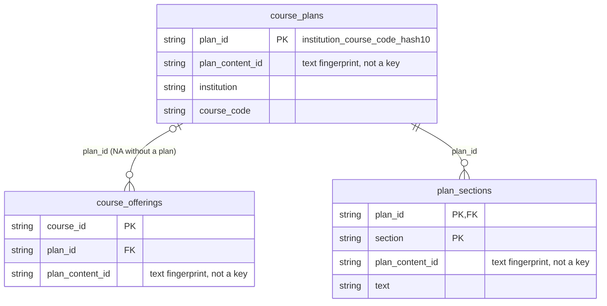

```{r}
#| echo: false
#| output: false
library(tidyverse)
```

## Data Files: Published and Internal

Files that hold raw page text (`html`, `extracted_text`) contain staff names,
e-mail addresses and phone numbers and are never published. Everything that is
shared is built from the anonymized text (`anonymize_text()`). The data are
kept in one folder per stage, so the folder says what may be shared:

| Folder | Holds | Written by | In git |
|---|---|---|---|
| `data/input/` | the DBH snapshots, the pipeline input | `data-raw/courses.R` | yes |
| `data/pilot/` | the pilot samples: offerings and their strata | `pilot_sample()` | yes |
| `data/raw/` | the harvest, with personal data; append-only | harvesting only | no |
| `data/releases/{tag}/` | offerings, plans and sections of a finalized release, both frames (the teacher-ed frame's in the folder, all courses' in `all/`), and `study_types.csv` (none yet: the first comes when coding starts) | `finalize_release()` | no |
| `data/backup/` | earlier harvests kept but not read (personal data) | by hand | no |
| `data/interim/` | text rebuilt from the harvest, with personal data; never shared | `targets::tar_make()` | no |
| `data/processed/` | anonymized data or data without text; can be shared | `targets::tar_make()` | no |

`data/processed/` may only hold text that went through `anonymize_text()`. The
pipeline checks this on every build: target `privacy_check` scans the files for
e-mail addresses, phone numbers, "Name (Role)" lines, "Name, dekan"
signatures, and role labels followed by a name ("faglærer Name",
"Emneansvarlige er: Name (sosionom)", a role heading over a name line) and
warns, and `tests/testthat/test-anonymize.R` fails, on any hit.
The repository is public. The plans are public pages too: anonymization
improves the data but is not legally required, and correct sections matter
as much (`methods.md` "Anonymization").

| File | Contents | Personal data | Status |
|---|---|---|---|
| `data/input/dbh_courses_{date}.parquet`, `dbh_programmes_{date}.parquet` | DBH tables 208 (courses) and 347 (programmes), the harvest input | none | in git |
| `data/input/dbh_exams_{date}.parquet`, `dbh_credits_{date}.parquet` | DBH tables 905 (exam registrations) and 900 (credits earned) per course and semester, which course-years had students; dated apart from the course list | none (counts) | in git |
| `data/raw/{inst}/{year}/{run}.parquet`, `data/raw/checkpoint/` | raw harvest: `html` (+ text and bytes of PDFs) | yes (raw) | internal |
| `data/raw/{inst}/ledger/{run}.parquet` | fetch ledger: URL, HTTP status, outcome and page hash per offering and run | none | internal |
| `data/pilot/{inst}.csv` | an institution's pilot sample (["Piloting an Institution"](new-institution.md#piloting-an-institution)) | none | in git |
| `data/variables.csv` | every variable of the published files, with its old name ("Variables") | none | in git; released with the data |
| `data/codes.csv` | the value labels of the coded columns of the published files, DBH's or the project's ("Variables", [Codebook](codebook.md)) | none | in git; released with the data |
| `data/study_types.csv` | DBH's study types (table 347 `Studiumkode`): Norwegian and English name, the project's group (`study_type_group` of the offerings, the browser's tree), years, `te_frame` (the teacher-ed frame's four) | none | in git; released with the data |
| `data/robots_txt.csv` | each host's robots.txt: date read, Crawl-delay, the disallow and allow rules the harvest applies (["robots.txt"](harvesting.md#robotstxt)) | none | in git |
| `data/interim/plan_gaps.RDS` | course-years without a plan, reason, URLs tried | none | internal |
| `data/interim/extracted_text.RDS` | `extracted_text` rebuilt from the raw harvest | yes (raw) | internal |
| `data/interim/course_offerings_full.RDS` | offerings + `url`, `extracted_text`, `course_plan` | yes (`extracted_text`) | internal |
| `data/processed/course_offerings.RDS` | DBH metadata + `plan_id` and the programme's study type, no text | none | published |
| `data/processed/course_plans.RDS` | anonymized `course_plan` (+ `course_plan_normalized`) | anonymized | published |
| `data/processed/plan_sections.RDS` | anonymized section `text` per plan | anonymized | publishable |
| `data/interim/teacher_ed/`, `data/processed/teacher_ed/` | the same files for the teacher-ed frame ("Frames") | as above | as above |
| `app/browser/public/data/` | the browser's data (target `browser_data_files`, [`app/browser/README.md`](../app/browser/README.md) "Data Contract"): plans, sections, course-years, metadata | anonymized (no `extracted_text`) | build output (gitignored), to be published with the page |
| `data/audit/` | audit findings (quotes from anonymized text) | staff names redacted | in git |

The scan catches text that skipped the anonymizer, not names the anonymizer
misses; the anonymization audit (`/audit-institutions anonymization`) checks
that per institution.

## Frames

The pipeline builds every offering in the raw store, and writes the data files
of two frames (`FRAMES`): `all`, every harvested offering, in `data/interim/`
and `data/processed/`; and `teacher_ed`, the offerings in the teacher-ed frame
of the latest DBH snapshot (`dbh_courses("teacher_ed")`, matched on the
offering without its status, `frame_members()`), in the `teacher_ed/` folders
of both (`frame_dir()`). The text, plan id and sections of a page are the same
in both; the plans are deduplicated within each frame (`frame_plans()`), so a
teacher-ed plan has the years, text and sections of its own earliest
teacher-ed offering, whatever else the raw store holds, and a harvest of other
courses leaves the teacher-ed files as they were. A release keeps both
frames (`finalize_release()`, since 2026-11-20): it cuts nothing, and users
filter by frame or study type. The teacher-ed files are the ones target
`frozen_check` checks once a release is finalized (none is yet, and until
the first it checks only the raw store), the ones `release_data()` hands to
the coding project by default, the browser's and `methods.md`'s; the data notes, the gaps and the audits read
those of all courses. Each frame has its metrics snapshot, and target
`coverage` its DBH offerings.

Per-institution prose notes are edited directly in `data/data_notes.qmd`.

## Data Structure

### Input Data (`data/input/dbh_*_{date}.parquet`)

```{r}
#| echo: false
#| output: false
for (f in c("R/utils.R", "R/fetch_html_cols.R", "R/extract_fulltext.R", "R/institution_config.R")) source(f)
```

The harvest's input is a dated snapshot of DBH's course list, written by
`data-raw/courses.R` from DBH's bulk files: `dbh_courses_{date}.parquet` is
table 208 (Emner), every course of every institution, year and semester, all
levels and statuses, one row per course and semester;
`dbh_programmes_{date}.parquet` is table 347 (Studieprogram), with the
programmes' study type (`Studiumkode`). Beside it, with dates of their own,
are DBH's student counts per course (code with its version, as table 208's)
and semester, at the institutions with a config, all years, from DBH's API:
`dbh_exams_{date}.parquet` is table 905 (Eksamensdata: exam registrations
`Oppmeldt totalt`, sat, passed) and `dbh_credits_{date}.parquet` table 900
(Studiepoeng: credits earned, `Ny produksjon totalt`, 1 = 60 credits). The
pipeline reads the latest of each, now the course list of
`r dbh_snapshot_date(dbh_snapshot_file("courses"))` and the counts of
`r dbh_snapshot_date(dbh_snapshot_file("exams"))` (methods.qmd, "Population
and sampling frame", says why they differ). The counts can be refreshed alone,
since they change only which course-years are marked as having had students,
not the frames:
`Rscript data-raw/courses.R counts` writes both tables of the day (about ten
minutes, one request per institution code and table, two seconds apart);
`Rscript data-raw/courses.R courses` the course list alone, and without an
argument both. `dbh_offered()` reads the latest counts for each course-year
(target `offered`), and every offering gets `exam_registrations`, `credits_earned`,
`had_students` and `counts_provisional` (`add_offered()`; see "Variables" and
methods.qmd): its course-year's counts, whether it had students (either
count above 0), and whether the year's counts can still grow, which follows from the counts' own date
(the years after the last one whose autumn both tables have). A new snapshot
gets a new date and the old ones stay. The snapshots keep DBH's column names.
`dbh_courses()` reads the latest (or the one of `date`), gives DBH's columns the pipeline's names
(`DBH_COLUMNS`; see "Variables") and adds `institution` and `course_code`:

```{r}
courses <- dbh_courses("teacher_ed")
courses |> slice(1:2)
```

`dbh_courses()` is every course; `dbh_courses("teacher_ed")` keeps the
courses of the teacher education programmes (study types in
`TEACHER_ED_STUDIUM`, matched on institution and programme code: a programme
code is unique only within an institution). The teacher-ed frame is a filter of
the same snapshot, so its offerings have the same `course_id` in both.
`harvest_all()` without `courses` harvests every course; `tar_make()` builds
everything in `data/raw/` and writes the teacher-ed frame's files apart (see
"Frames").

A study type (`Studiumkode` in table 347) is DBH's classification of a
programme: a profession (SYK nursing, ING engineering, PRAKTPED the
practical-pedagogical education), a programme model (GLU1-7, IMALU1-7) or a
broad field (HUMAN, REALFAG, SAMVIT). DBH registers it per programme and
semester; a programme can change type within a year (956 programme-years
in the snapshot of 2026-11-08), never within a semester.
`data/study_types.csv` lists the study types of the latest snapshot with
DBH's Norwegian name, an English name, a group for the browser's study-type
tree (teacher education, health and welfare, broad fields and so on), the
years they appear, and `te_frame`. The teacher-ed frame is four of them
(INTMASTER, IMALU1-7, IMALU5-10 and LUPE, `TEACHER_ED_STUDIUM`; methods.qmd,
"Population and sampling frame"), marked `te_frame`; the other teacher
education study types (GLU, PRAKTPED, BLU and others) are in the group but
outside the frame. `tests/testthat/test-study-types.R` checks that the file
covers the latest snapshot and that `te_frame` matches `TEACHER_ED_STUDIUM`:
a new snapshot with a new study type needs a row added by hand.

### Study Types of the Offerings

Every offering carries the study type of its programme that semester
(`programme_study_types()`, `add_study_types()`; methods.qmd, "Study type
of an offering"): `study_type_code` (`Studiumkode`) and `study_type_name`
(`Studnavn`, DBH's Norwegian name), from table 347 of the same snapshot as
the course list, joined on `institution_code`, `programme_code`, `year` and
`semester`; and `study_type_group`, the project's group of the type, column
`group` of `data/study_types.csv` (eight groups made for the browser on
2026-11-19, not a DBH classification). They are NA where the programme has
no table 347 row that semester (one offering in the snapshot of
2026-11-08). The study type is that of the one programme DBH registers the
offering under (table 208 has one programme per course and semester): a
course that other programmes use too shows only that programme's type, and
a course registered under different programmes in different semesters has
the type of each. The file
`study_types.csv` goes with every release as the definition of the groups.

The offerings keep DBH's keys, so other DBH tables join to them:
`institution_code` (DBH's institution code), `programme_code` (unique only
within an institution), `course_code_raw` (DBH's course code with its
version number, as in tables 208, 900 and 905), `year` and `semester`
(0 winter, 1 spring, 2 summer, 3 autumn). A programme table (such as 347)
joins on `institution_code`, `programme_code`, `year` and `semester`; a
course table (such as 900 or 905) on `institution_code`, `course_code_raw`,
`year` and `semester`.

Key columns:
- `institution`: Short code (e.g., "oslomet", "uia"); NA for an institution code no config has
- `course_code_raw`: DBH's course code (used in `course_id`)
- `course_code`: the code with the trailing version number removed (`canon_remove_trailing_num()`: "ABC123-1" → "ABC123")
- `year`, `semester_name` ("Vår", "Høst", "Sommer", "Vinter"; `canon_semester_name()` gives `course_id` spring, autumn, summer)
- `programme_code`, `programme_name`: the programme DBH registers the course under (one per row)
- `status`: course status (1 active, 2 new, 3 discontinued, 4 discontinued with active students). It is the last part of `course_id`, and a later snapshot can change it: an offering already in a raw file keeps the id it was first harvested under (`first_course_id()`)

DBH lists most courses under both semesters of a year, also when they are
taught in one. Where pages are semester-specific, about half the rows therefore
have no plan by design; see "Semester registration in DBH" in
`data/data_notes.qmd` before reading row-level success rates.

`harvest_institution()` returns the offerings with `course_id`, `url`, `html`,
`html_error`, `html_success` and `extracted_text` added, the rows of the raw
store (["Raw Store and Finalized Releases"](rebuilding.md#raw-store-and-finalized-releases)).

### Keys of the Published Files



Join offerings, plans and sections on `plan_id`
(`{institution}_{course_code}_{first 10 characters of plan_content_id}`, since
2026-11-19), which is unique per plan. `plan_content_id` is a hash of the
normalized text, shared by parallel course codes of an institution that
publish the same text, so it finds identical texts across courses, and a join
on it alone duplicates offerings (methods.qmd, "Unit of analysis: the unique
plan").

### Variables (`data/variables.csv`)

`data/variables.csv` documents every variable of the published files
(`course_offerings.RDS`, `course_plans.RDS`, `plan_sections.RDS`, of both
frames): the file, its name, type, source (the column of the DBH table, or
how the pipeline gives it), meaning and codes, and `old_name`, its name until
2026-10-16. `release_data()` hands it over with the data,
and `tests/testthat/test-dbh-input.R` checks it against the built files and
`DBH_COLUMNS`. `course_offerings_full.RDS` (internal) adds `url`,
`extracted_text`, `course_plan`, `course_plan_normalized` and `plan_nchar`.

The allowed values of the coded columns are in `data/codes.csv` (variable,
code, English label, source DBH or project, description; one row per value,
for every file with the column), except the study types and their groups,
which `data/study_types.csv` holds (`release_codes()` joins the two). Open DBH
code lists (language, subject, NUS, unit, programme) are not listed. The
[Codebook](codebook.md) (`docs/codebook.qmd`) is rendered from these tables
with the keys of the files (`RELEASE_KEYS`), and so is the release's
`datapackage.json`, a Data Package (v2) descriptor of the Parquet copies of the
three files: field types, the codes as enum constraints with labels, primary
and foreign keys (`datapackage_descriptor()`). `release_data()` writes the
Parquet copies and the descriptor beside the RDS files, stops if the tables do
not match it (`check_datapackage()`), and hands over `codes.csv` and the
codebook; `tests/testthat/test-release.R` checks the built teacher-ed files
against the descriptor. A new code in the data (a DBH level, a new
institution) needs a row in `codes.csv`, and the codebook rendered again.

Since 2026-10-16 the DBH columns have English snake_case names (methods.qmd,
"Variable names"); their values are DBH's (Norwegian names, DBH's codes), and
`year_from` and `year_to` are integers (double before). DBH's snapshots, the
raw files of the harvests until 2026-10-16 and the data handed to the coding
project on 2026-10-15 (the retired release data-2026-10-15) have DBH's names:
the pipeline renames them where it reads such data (`dbh_rename()`, in
`dbh_courses()`, `read_raw()` and `release_data()`). Code that reads such data
can rename them by the same pairs:

```{r}
#| eval: false
v <- read.csv("data/variables.csv")
pairs <- unique(v[v$old_name != v$variable, c("variable", "old_name")])
old <- readRDS("../TEPS_course_content_coding/data/course_offerings.RDS") |>
  dplyr::rename(dplyr::any_of(setNames(pairs$old_name, pairs$variable)))
```

```{r}
#| echo: false
v <- read.csv("data/variables.csv")
knitr::kable(v)
```
